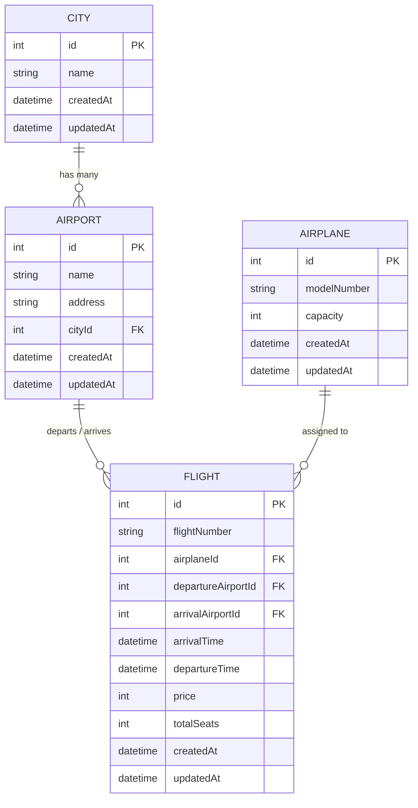

# Flights and Search Service

## Overview
The **Flights and Search Service** is the core catalog and inventory microservice of the Airline Reservation system. It manages and exposes real-time data for Cities, Airports, Airplanes, and Flights. Downstream services—including the **Airline Booking Service**—rely on this service to query available itineraries, verify seat inventory, calculate ticket pricing, and deduct available seats upon booking confirmation.

---

## Tech Stack
- **Runtime**: Node.js (v18+)
- **Framework**: Express 5
- **ORM**: Sequelize v6
- **Database**: MySQL (`mysql2` driver)
- **Environment Management**: `dotenv`
- **Development Tooling**: `nodemon`, `sequelize-cli`

---

## Domain & Database Model



---

## Environment Variables

Copy `.env.example` to create `.env`:

```bash
cp .env.example .env
```

| Variable Name | Required | Default Value | Description |
| :--- | :---: | :--- | :--- |
| `PORT` | Required | `3000` | Port on which the service listens. Booking Service points to this port. |
| `SYNC_DB` | Optional | `false` | When set to `true`, auto-syncs database models with `alter: true`. |
| `NODE_ENV` | Optional | `development` | Active environment (`development`, `test`, `production`). |

### Database Configuration (`src/config/config.json`)
Sequelize reads database connection properties from `src/config/config.json`. A reference file is provided at `src/config/config.json.example`:

```json
{
  "development": {
    "username": "root",
    "password": "your_mysql_password",
    "database": "Flights_Search_DEV",
    "host": "127.0.0.1",
    "dialect": "mysql"
  }
}
```

---

## Prerequisites & Installation

### Prerequisites
1. **Node.js**: v18.0.0 or higher
2. **MySQL Server**: v8.0 or higher running on `127.0.0.1:3306`

### Installation Steps

1. Navigate to the service folder:
   ```bash
   cd Airline-Search-Service-
   ```

2. Install dependencies:
   ```bash
   npm install
   ```

3. Setup environment and database configurations:
   ```bash
   # Copy environment file
   copy .env.example .env

   # Copy and configure database credentials
   copy src\config\config.json.example src\config\config.json
   ```

4. Database creation and migrations:
   ```bash
   # Create database
   npx sequelize db:create

   # Apply schema migrations (Cities, Airports, Airplanes, Flights)
   npx sequelize db:migrate

   # Seed initial airplane and airport datasets
   npx sequelize db:seed:all
   ```

5. Run the service:
   ```bash
   # Start with auto-reloading
   npm start
   ```

---

## API Endpoints & Routes

All routes are mounted under `/api/v1`.

### 1. City Endpoints
- **Create City**: `POST /api/v1/city`
  - Body: `{ "name": "Mumbai" }`
- **Get City by ID**: `GET /api/v1/city/:id`
- **Search Cities**: `GET /api/v1/city?name=Mum`
- **Update City**: `PATCH /api/v1/city/:id`
  - Body: `{ "name": "Navi Mumbai" }`
- **Delete City**: `DELETE /api/v1/city/:id`

---

### 2. Airport Endpoints
- **Create Airport**: `POST /api/v1/airports`
  - Body:
    ```json
    {
      "name": "Chhatrapati Shivaji Maharaj International Airport",
      "address": "Sahar, Mumbai",
      "cityId": 1
    }
    ```

---

### 3. Flight Endpoints

#### Create Flight
- **URL**: `POST /api/v1/flights`
- **Headers**: `Content-Type: application/json`
- **Request Body**:
  ```json
  {
    "flightNumber": "AI-101",
    "airplaneId": 1,
    "departureAirportId": 1,
    "arrivalAirportId": 2,
    "arrivalTime": "2026-10-25 14:00:00",
    "departureTime": "2026-10-25 11:30:00",
    "price": 5200,
    "totalSeats": 180
  }
  ```
- **Validation**: All fields are validated via middleware before creation.

#### Query & Filter Flights
- **URL**: `GET /api/v1/flights`
- **Query Parameters**:
  - `minPrice`: Minimum ticket cost (e.g. `?minPrice=3000`)
  - `maxPrice`: Maximum ticket cost (e.g. `?maxPrice=7000`)
  - `trip`: Departure and Arrival airport route filter (e.g. `?trip=1,2`)

#### Get Flight by ID (Used by Booking Service)
- **URL**: `GET /api/v1/flights/:id`
- **Response** (`200 OK`):
  ```json
  {
    "data": {
      "id": 1,
      "flightNumber": "AI-101",
      "airplaneId": 1,
      "departureAirportId": 1,
      "arrivalAirportId": 2,
      "price": 5200,
      "totalSeats": 180,
      "departureTime": "2026-10-25T11:30:00.000Z",
      "arrivalTime": "2026-10-25T14:00:00.000Z"
    },
    "success": true,
    "message": "Successfully fetched the flight",
    "err": {}
  }
  ```

#### Update Flight / Deduct Available Seats (Used by Booking Service)
- **URL**: `PATCH /api/v1/flights/:id`
- **Request Body**:
  ```json
  {
    "totalSeats": 178
  }
  ```
- **Response** (`200 OK`):
  ```json
  {
    "data": {
      "id": 1,
      "totalSeats": 178
    },
    "success": true,
    "message": "Successfully updated the flight",
    "err": {}
  }
  ```
